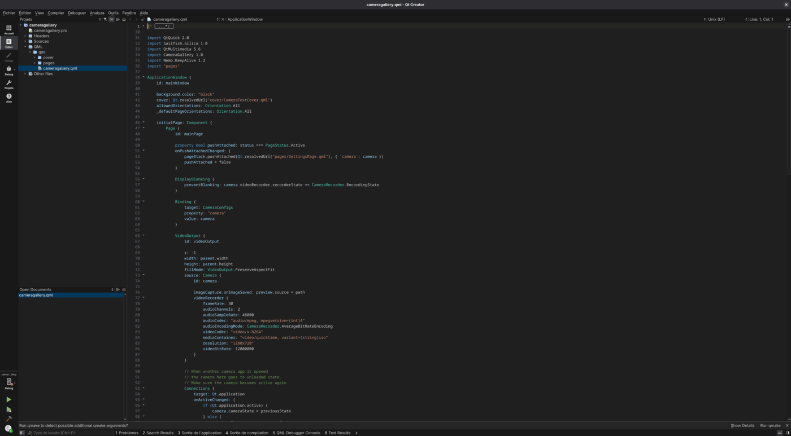
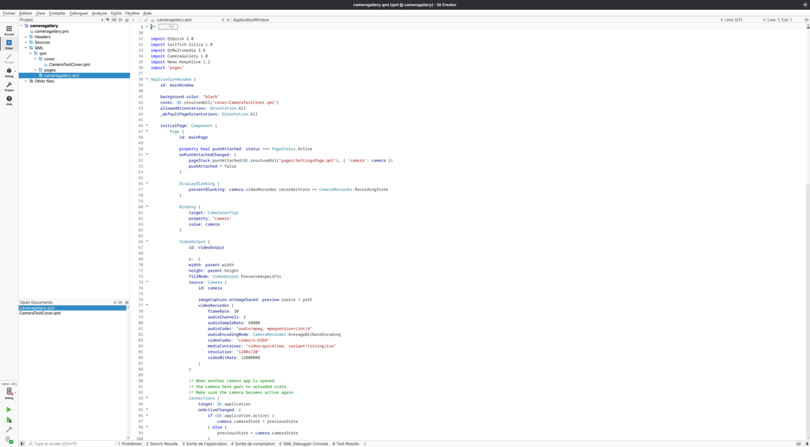

# qtcreator-vscode-dx

I'm used to VS Code, so I made Qt Creator look and feel like it: same theme,
same editor colours, same main shortcuts. It's made for the Qt Creator that
comes with the Sailfish SDK.





## Install

Quit Qt Creator first, then:

```sh
git clone https://github.com/erwanlpfr/qtcreator-vscode-dx
cd qtcreator-vscode-dx
./install.sh        # or ./install.sh light
```

Your original settings are saved as `QtCreator.ini.bak` the first time. Copy
it back over `QtCreator.ini` to undo everything.

If Qt Creator lives somewhere else, set `QTC_PREFIX` (the install folder) and
`QTC_CONFIG` (the folder with `QtCreator.ini`).

## Shortcuts

Ctrl+P, F12, Shift+F12, F2, Ctrl+G, Alt+Up/Down, Ctrl+Shift+K, Ctrl+B and
Ctrl+Shift+B work like in VS Code. The full list is in `keyboard/vscode.kms`.
Edit it to change them, or import it in Qt Creator if you only want the
shortcuts.

## Tiny window on a HiDPI screen?

Add `QT_FONT_DPI=96 QT_SCALE_FACTOR=2` after `env` on the `Exec=` line of
`~/.local/share/applications/SailfishSDK-qtcreator.desktop`.

## License

MIT. The colours come from VS Code, see [NOTICE](NOTICE). This project is not
related to Microsoft. Visual Studio Code is a trademark of Microsoft
Corporation.
